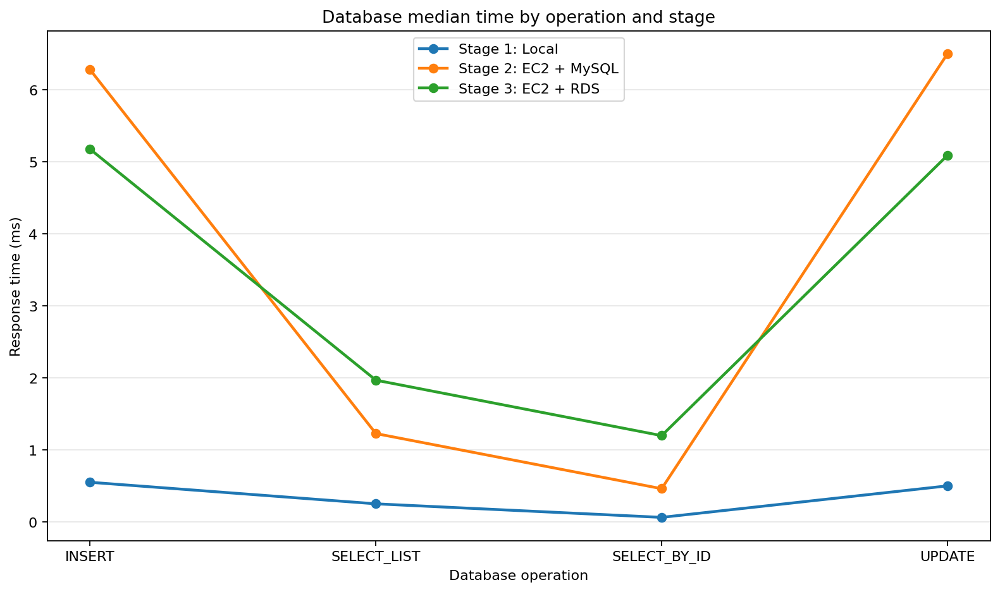
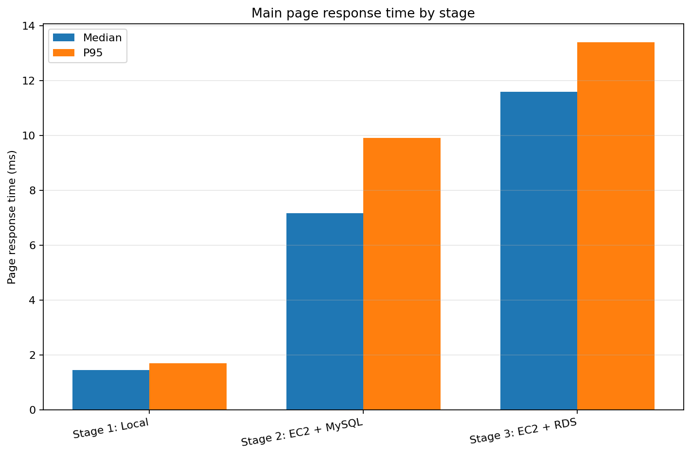
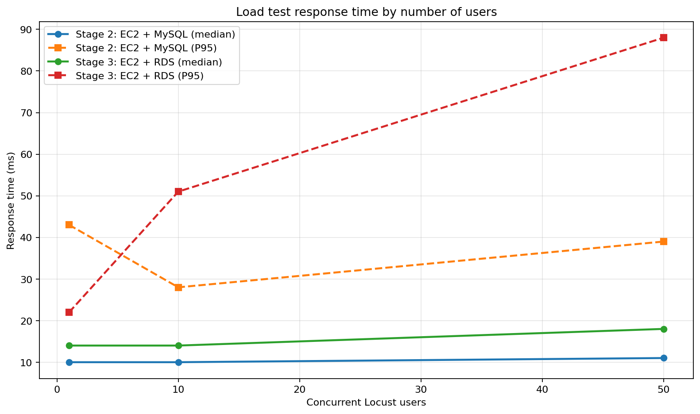

# Project results

Service Request Management System, moved from a laptop to AWS in three stages. This document puts all the main numbers from the project in one place.

## The three stages

| Stage | App runs on | Database runs on |
|---|---|---|
| Stage 1: Local | Laptop (Docker) | MySQL in Docker on the laptop |
| Stage 2: Lift and shift | AWS EC2 t3.micro | MySQL in Docker on the same EC2 |
| Stage 3: Refactor | AWS EC2 t3.micro | AWS RDS MySQL db.t3.micro |

The app code is the same in every stage. Moving from Stage 2 to Stage 3 only changed the database address and login in the settings. All AWS resources were in the Mumbai region. Every test used the same 1,000 rows of sample data, and the cloud tests ran from inside the EC2 instance.

All times are in milliseconds (ms), and lower is better. The median is a typical result. P95 means 95 out of 100 results were this fast or faster.

## 1. Database speed

A script ran each database operation 500 times, and this was repeated for every stage.

| Operation (median) | Stage 1 | Stage 2 | Stage 3 |
|---|---|---|---|
| Add a request | 0.55 ms | 6.28 ms | 5.17 ms |
| List requests | 0.25 ms | 1.23 ms | 1.97 ms |
| Find one request | 0.07 ms | 0.46 ms | 1.20 ms |
| Update a request | 0.50 ms | 6.50 ms | 5.09 ms |

What this shows:

1. Stage 1 is the fastest because the laptop is much more powerful than a t3.micro.
2. Reading data is slower on RDS, because every query travels over the network to a separate server.
3. Adding and updating data was a little faster on RDS than on Stage 2. A likely reason is that RDS has its own machine and storage for the database.

## 2. Page load speed

The main page was loaded 100 times, and this was repeated 3 times for every stage.

| | Stage 1 | Stage 2 | Stage 3 |
|---|---|---|---|
| Median | 1.45 ms | 7.16 ms | 11.58 ms |
| P95 | 1.69 ms | 9.91 ms | 13.39 ms |

Each page load runs database queries, so the network trip to RDS adds a few milliseconds.

## 3. Load test with many users

Locust acted like 1, 10 and 50 people using the app at the same time. Each test ran for 60 seconds and was repeated 3 times. The simulated users opened the request list, added requests and updated their status. Only Stage 2 and Stage 3 were load tested, because the laptop is far more powerful than the cloud machine and would not give a fair comparison.

| Users | Stage 2 median | Stage 3 median | Stage 2 P95 | Stage 3 P95 |
|---|---|---|---|---|
| 1 | 10 ms | 14 ms | 43 ms | 22 ms |
| 10 | 10 ms | 14 ms | 28 ms | 51 ms |
| 50 | 11 ms | 18 ms | 39 ms | 88 ms |

Each number is the middle value of the 3 runs.

| | Stage 2 | Stage 3 |
|---|---|---|
| Total requests | 10,568 | 10,501 |
| Failed requests | 0 | 0 |

What this shows:

1. Not one request failed in all 18 runs.
2. Stage 2 stayed fast as users grew. On RDS the typical time rose from 14 ms to 18 ms, and the P95 rose to 88 ms at 50 users.
3. RDS had the better P95 with only 1 user.
4. Our plan expected RDS to do better at 50 users, because the app and the database would no longer share one small machine. That did not happen at this load.

## 4. Monthly cost

| Item | Stage 2 | Stage 3 |
|---|---|---|
| EC2 t3.micro | 8.18 USD | 8.18 USD |
| EC2 disk, 20 GB | 1.82 USD | 1.82 USD |
| RDS db.t3.micro | Not used | 18.25 USD |
| RDS storage, 20 GB | Not used | 2.62 USD |
| **Total per month** | **10.00 USD** | **30.87 USD** |

Prices come from the AWS Pricing Calculator for Mumbai, on demand, 730 hours a month, checked on 14 Nov 2026. Tax and data transfer are not included. Stage 3 costs about 3 times as much. Adding a standby copy of the database (Multi AZ) would roughly double the RDS part.

## 5. Setup effort

| Stage | Time | Main steps |
|---|---|---|
| Stage 1 | Not timed | Quick. The app moved to port 8000 because macOS already uses port 5000. |
| Stage 2 | 40 min | EC2 and security group 15, Docker and settings 10, seeding and testing 15 |
| Stage 3 | 28 min | RDS and security group 15, database and app settings 8, testing 5 |

Stage 3 reused the EC2 machine from Stage 2, so its time covers only the database move.

## 6. Who looks after the database

| Task | MySQL on EC2 | RDS |
|---|---|---|
| Install and set up | Us | AWS |
| Backups | Us, and none were set up | AWS, daily and automatic |
| Restore after data loss | Us, by hand | From a snapshot in the console |
| Security updates | Us | AWS |
| Monitoring | Us | Built in (CloudWatch) |
| If the machine fails | The database is down | Optional standby copy at extra cost |
| Making the database bigger | Resize the whole machine | Resize only the database |

## Conclusion

Stage 2 is the fastest cloud option and costs about 10 USD a month. Stage 3 costs about 31 USD a month and adds a few milliseconds to reads because of the network trip. In return AWS takes care of backups, updates and monitoring, and the database can grow on its own. The app stays quick and reliable in both setups, so for this project the real choice is between lower cost and less maintenance work.

## Limits

1. Each load test lasted only 60 seconds, and 50 users is a small load.
2. We used the smallest machine sizes.
3. Each cloud stage was tested on one machine, on one day.

## Where to find the data

| What | Where |
|---|---|
| Charts | `results/generated_charts/` |
| Summary tables | `results/summary_tables/` |
| Raw database and page timings | `results/` (the stage CSV files) |
| Raw load test files | `results/locust/` |
| AWS pricing screenshots | `docs/screenshots/` |
| Screenshots of the tests on AWS | `evidence/screenshots/` |

To rebuild the charts and summary tables, run `python results/make_charts.py` from the project folder.
